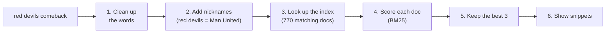
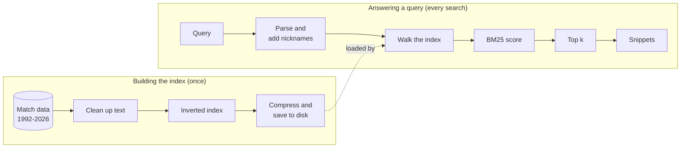
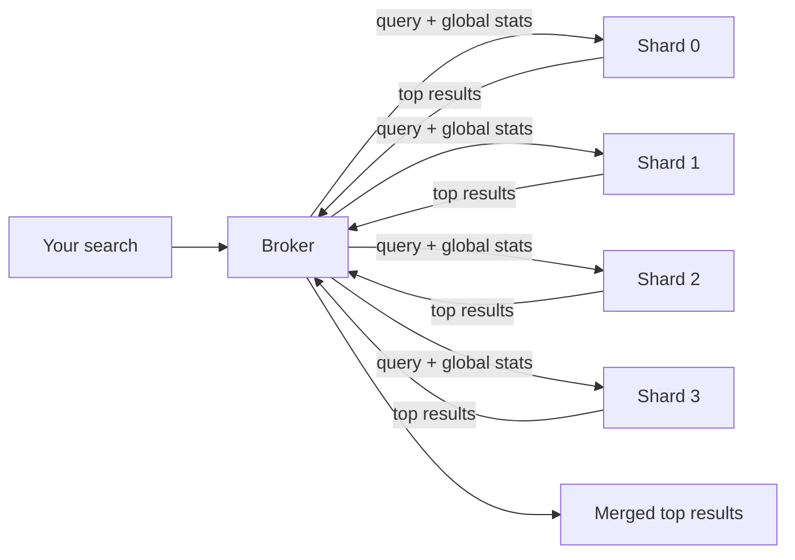

# Ask the Gaffer

[](https://github.com/siddharth-sarma5/gaffer-search/actions/workflows/ci.yml)

**A search engine for Premier League football, built from scratch in C++20.**

Type `red devils comeback` and it finds Manchester United's comeback wins. Type
`"north london derby"` and it finds Arsenal against Tottenham. It searches 13,724 documents
(matches, players, clubs and seasons from 1992 to 2026) and ranks the best answers first, the
way a web search engine does.

Nothing is borrowed from a search library. Every part is written by hand: reading the text,
building the index, ranking results, compressing the index, and spreading the work across several
servers that talk over the network. The goal was to learn how real search engines work, and to
show it with measured numbers and thorough tests.

## At a glance

| | Result | In plain English |
|---|---|---|
| **Speed** | 33 µs typical query over 13,724 docs | A search takes about 0.03 milliseconds |
| **Size** | Index compressed to 20% of its raw size | Stores the same information in a fifth of the space |
| **Quality** | Finds 90% of the right answers in its top 10 (0.67 without nickname expansion) | Knowing that "Gunners" means Arsenal makes a big difference |
| **Scale** | Same rankings on 1 to 4 servers as on one machine (tested) | Splitting the data across machines doesn't change the answers |
| **Reliability** | Returns partial results when a server fails or is slow | One broken server doesn't break the search |
| **Testing** | 225 C++ tests on every push, plus memory and thread-safety checkers | Every module is tested, including deliberate failures |

## See it work: one query, step by step

Here is what happens when you search for **`red devils comeback`**. All output below is real.



**1. Clean up the words.** Text is split into words, lowercased and stripped of accents, and plurals
are trimmed, so "Devils" becomes `devil`. Documents went through the same steps when they were
indexed, so the words line up.

**2. Add nicknames.** The engine knows "red devils" means Manchester United, so it also searches
for `manchester` and `united`, at slightly lower weight (×0.7).

```text
Kick-off: red (df 597), devil (df 1), comeback (df 46),
          manchester (df 197, from "red devils" x0.7), united (df 375, from "red devils" x0.7)
```

`df` is how many documents contain the word. `devil` is in just one document, so it's a strong
clue. `red` is in 597, so on its own it's a weak one.

**3. Look up the index.** Like the index at the back of a book, the engine keeps a list of every
document that contains each word. It walks these lists side by side and finds the 770 documents
that contain at least one of the words.

**4. Score each document.** Each document gets a relevance score from **BM25**, the formula behind
many real search engines. Rare words count more than common ones, a word used several times counts
more (with diminishing returns), and long documents don't win just by being long. Adding `--var` (a "VAR review")
shows exactly where the points came from:

```text
1. Manchester United                                      9.865  club
   VAR review (doc length 111, average 101.9):
     red                                tf  2  idf  0.45  x1.0  ->   0.606
     devil                              tf  1  idf  6.44  x1.0  ->   6.211
     comeback                           not in this document
     manchester (from red devils)       tf  6  idf  1.56  x0.7  ->   1.979
     united (from red devils)           tf  4  idf  0.92  x0.7  ->   1.069
                                                                 total   9.865
```

**5. Keep the best 3.** A small "leaderboard" (a min-heap) holds the top results seen so far.
Each new document only gets in if it beats the weakest entry, so the engine never has to sort all 770.

**6. Show snippets.** For each result the engine picks the passage with the most search words and
highlights them:

```text
  1. Manchester United                                      9.865  club
  2. Manchester United 2-1 Crystal Palace (1 Mar 2026)      6.629  match
     ... **Manchester** **United** came from a goal down to win, a **comeback**. Crystal Palace led ...
  3. Arsenal 2-3 Manchester United (25 Jan 2026)            6.337  match

Full-time: 3 of 770 matching documents in 0.14 ms
```

> **Interactive version:** [docs/visualiser/index.html](docs/visualiser/index.html) walks through
> this query in both single-server and cluster mode, and maps every source file. Download it and
> open it in any browser; there's nothing to build.

## How it's built

### On one machine



| Concept | What it does here | Where |
|---|---|---|
| **Tokenizing and stemming** | Turns "Ødegaard" into `odegaard` and "winners" into `winner` | `src/text/` |
| **Inverted index** | For every word, the documents and positions where it appears | `src/index/` |
| **Phrase search** | `"late winner"` must appear as adjacent words, in order, checked using the stored positions | `src/query/phrase.cpp` |
| **BM25 ranking** | Industry-standard relevance score | `src/ranking/` |
| **Top-k selection** | A min-heap keeps the best k results without sorting everything | `src/query/top_k.cpp` |
| **Compression** | Stores gaps between document numbers, not the numbers themselves, in as few bytes as possible (delta + varint) | `src/index/postings_codec.cpp` |
| **Safe index file** | A checksum (CRC-32) and a fingerprint of the source data reject damaged or outdated files | `src/index/index_file.cpp` |
| **Query expansion** | Nicknames ("Gunners", "Toffees") also search for the club's name | `src/query/nicknames.cpp` |

### Across several servers

The data is split into **shards**, one per server. A **broker** receives each search, asks every
shard at once, and merges their answers. All of it runs over a custom network protocol written
directly on TCP sockets.



Three problems had to be solved:

- **Same answers as one machine.** A word can be rare on one shard and common on another, which
  would skew the scores. The broker collects corpus-wide word counts from all shards and sends
  the relevant ones with each query. Tests confirm the sharded results match a single machine to
  the last bit.
- **Slow or dead servers.** Every query has a deadline. If a shard misses it, the broker returns
  what it has and says so (`PARTIAL RESULTS: 3 of 4 shards answered`) instead of failing.
- **Many connections at once.** Each server uses one event loop (`poll()`) that hands work to a
  pool of threads. An earlier design gave every connection its own thread. A concurrency test
  caught new clients waiting forever because idle connections were holding every thread, so the
  server was redesigned.

More detail, with diagrams and trade-offs: [docs/ARCHITECTURE.md](docs/ARCHITECTURE.md). Every
design decision and the alternatives considered: [docs/DECISIONS.md](docs/DECISIONS.md).

## Benchmarks

Measured with the project's own tools (`gaffer-bench`, `gaffer-eval`) on a small cloud machine
with 2 CPU cores. µs means microseconds, millionths of a second. **p50** is the typical
(median) query. **p99** is a slow one: 99 out of 100 queries are faster.

### Speed and size

| | Recent season (938 docs) | All seasons (13,724 docs) | What it means |
|---|---:|---:|---|
| Typical query (p50) | **4.3 µs** | **32.9 µs** | Time for one search |
| Slow query (p99) | 24.4 µs | 436.7 µs | Even slow searches finish in under half a millisecond |
| Indexing speed | 27,377 docs/s | 94,581 docs/s | How fast it builds the index |
| Index size after compression | **21.4%** of raw | **20.0%** of raw | 7.15 MB shrinks to 1.43 MB on the full set |
| Loading a saved index | 4.4 ms | 18.2 ms | Includes checking it for damage |

The machine was shared, and a second run of the large test gave 26.4 µs (p50) and 279.3 µs (p99).
Treat these as the right ballpark, not exact figures.

### Search quality

Tested on 20 questions whose correct answers were decided from the match data, never from the
engine's own output. Details: [eval/](eval/README.md).

| | Right answers found in top 10 (recall@10) | Top 5 that are right (P@5) | How high the first right answer ranks (MRR) |
|---|---:|---:|---:|
| With nickname expansion | **0.895** | **0.520** | **0.718** |
| Without | 0.670 | 0.400 | 0.628 |

In plain terms: teaching the engine that "Gunners" means Arsenal raised the share of right
answers found from 67% to about 90%. (P@5 looks low partly because many questions have fewer
than 5 right answers.)

### Adding more servers

Typical (p50) and slow (p99) times for one complete search including snippets, all 13,724 docs:

| Setup | Typical (p50) | Slow (p99) |
|---|---:|---:|
| One machine, no network (baseline) | 183 µs | 618 µs |
| 1 shard behind the broker | 493 µs | 1,261 µs |
| 2 shards | **427 µs** | 1,297 µs |
| 4 shards | 723 µs | 2,171 µs |
| 8 shards | 1,230 µs | 3,422 µs |

**What this means:** at this data size, one machine is fastest, because sending messages over
the network costs more than the search itself. Two shards beat one by using both CPU cores.
Beyond that, this 2-core test machine runs out of cores, and every shard also builds its own
snippets, so the extra work outweighs the gain. The point of sharding is to handle data too big
for one machine and to survive server failures, and the tests show both work. The known next
step is to build snippets only for the final results ("query-then-fetch"). Full method and raw
data: [bench/README.md](bench/README.md).

## How it's tested

- **225 C++ tests** run on every push, with two compilers (GCC 13, Clang 18).
- **Memory and thread checkers** (AddressSanitizer, UndefinedBehaviorSanitizer, ThreadSanitizer)
  run on every push, so memory bugs and data races fail the build.
- **Checked against simple reference versions:** top-k against a full sort, index walking against
  scoring every document, phrase search against a plain scan.
- **Damaged input:** every truncation and every single-byte change of an index file, every
  truncation of every network message, and 20,000 random messages are all rejected cleanly.
- **Failure testing:** shards that are slow, dead, restarted, silent or sending garbage.
- **Full cluster in CI:** Docker starts 4 shards and a broker, stops one shard, and checks that
  the answer is flagged as partial.
- **Style and static analysis:** clang-format and clang-tidy on every push; compiler warnings are treated as errors.

## Run it yourself

Needs Linux (or WSL2 on Windows). On Ubuntu 24.04:

```sh
sudo apt install -y build-essential cmake ninja-build git python3 \
  clang-18 clang-format-18 clang-tidy-18 libclang-rt-18-dev
git clone https://github.com/siddharth-sarma5/gaffer-search && cd gaffer-search
cmake --preset release && cmake --build --preset release
G=./build/release/apps/gaffer

$G search "late winner at anfield"          # ranked results with snippets
$G search '"north london derby"'            # exact phrase
$G search "red devils comeback" --var       # nicknames + score breakdown
$G search                                   # interactive: one query per line
```

<details>
<summary>More commands: saved index, benchmarks, cluster, Docker, tests, options</summary>

```sh
$G index --out pl.gaffer                    # build and save a compressed index
$G search --index pl.gaffer "palmer hat-trick"

./build/release/apps/gaffer-bench --corpus data/corpus/pl-history.tsv --corpus data/corpus/pl-2025-26.tsv
./build/release/apps/gaffer-eval            # search quality on 20 labelled queries

# A 4-shard cluster over all 13,724 docs (local processes; Ctrl-C stops it)
deploy/local-cluster.sh 4 7000 &
$G search --broker 127.0.0.1:7000 "late winner at anfield"

# The same cluster with Docker
docker compose -f deploy/docker-compose.yml up --build -d
docker compose -f deploy/docker-compose.yml run --rm client gaffer search --broker broker:7000 "gunners"

# Tests with the memory checkers
cmake --preset asan && cmake --build --preset asan && ctest --preset asan
python3 -m unittest discover -s tools/corpusgen/tests -t tools/corpusgen
```

Search options: `-k N`, `--k1 X`, `--b X`, `--no-stem`, `--keep-stopwords`, `--corpus PATH`
(repeatable), `--index PATH`, `--broker HOST:PORT`, `--nicknames PATH`, `--no-expand`, `--var`.

Requirements: CMake ≥ 3.24, Ninja, GCC ≥ 13 or Clang ≥ 18. GoogleTest is downloaded
automatically. On Ubuntu 22.04 the stock CMake and GCC are too old: install `g++-13` from
`ppa:ubuntu-toolchain-r/test` and CMake with `pip install --user "cmake>=3.24"`, then
`export CXX=g++-13`. On WSL, clone into your Linux home directory, not `/mnt/c`, for much faster
builds. Native Windows/MSVC isn't supported because the networking code is POSIX-only.

</details>

## Project layout

```text
src/text/      cleaning up text: tokenizer, accent folding, stopwords, stemmer
src/index/     inverted index, compression, saved index file, sharding math
src/query/     query parsing, nicknames, phrase matching, the search loop, top-k
src/ranking/   BM25 scoring and the VAR score breakdown
src/snippet/   picking and highlighting snippets
src/net/       sockets, message framing, the network protocol
src/server/    shard server, broker, shared statistics
apps/          gaffer (CLI), gaffer-shard, gaffer-broker, gaffer-bench, gaffer-eval
tools/corpusgen/  Python script that turns raw match data into searchable documents
tests/         225 C++ tests      deploy/  Docker and local cluster scripts
```

## Docs

[Requirements](docs/REQUIREMENTS.md) · [Plan](docs/PLAN.md) · [Architecture](docs/ARCHITECTURE.md) ·
[Decisions](docs/DECISIONS.md) · [Progress](docs/PROGRESS.md) · [Benchmarks](bench/README.md) ·
[Evaluation](eval/README.md) · [Code tour](docs/visualiser/index.html)

The project was built in three milestones, all complete: **(1)** search on one machine,
**(2)** phrases, compression, snippets, nicknames, benchmarks and quality evaluation,
**(3)** sharded servers, a broker, and handling of failures.

## Data and licence

Match data: [openfootball/england](https://github.com/openfootball/england), public domain (CC0),
pinned to a fixed version ([provenance](data/raw/openfootball/PROVENANCE.md)). Every document is
generated from match facts; no articles or written match reports are used. Code: MIT.
