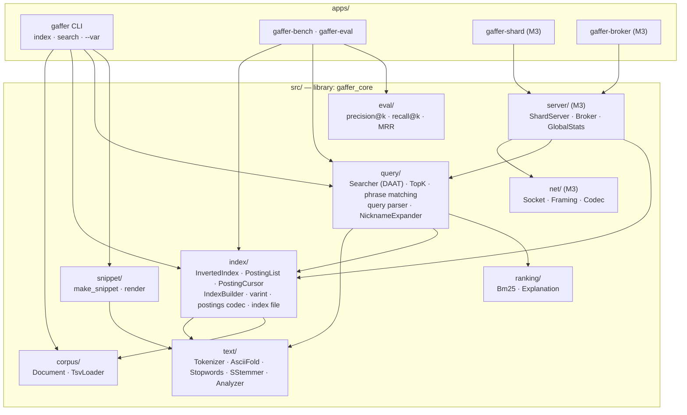
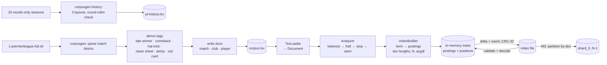
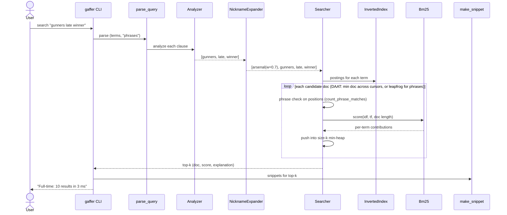
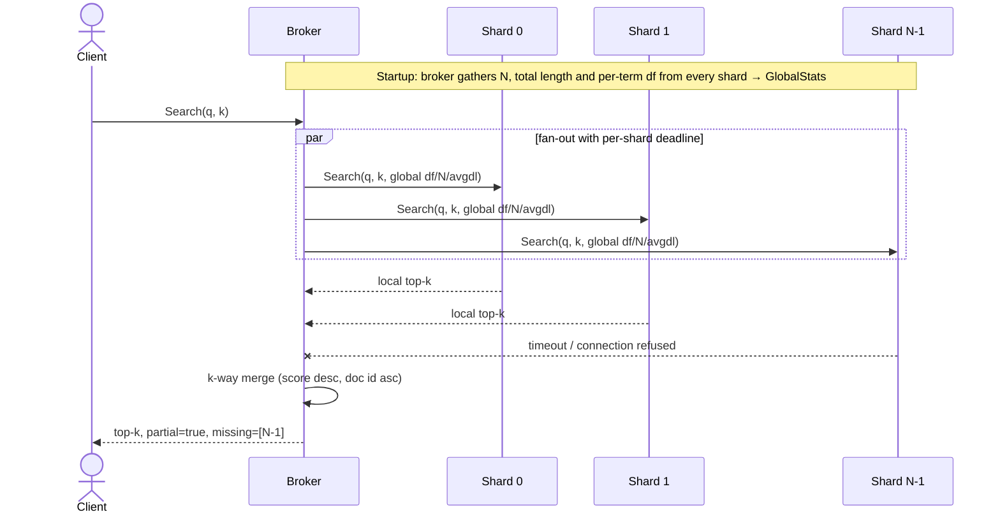

# Architecture

*Status: Milestones 1 and 2 built (2026-11-03). Parts marked **(M3)** are planned, not built.
These diagrams are updated whenever the design changes.*

## 1. System context

## 2. Components

Dependency rule: arrows point downwards only. `text/` and `corpus/` depend on nothing else in
the project, so each module can be unit-tested in isolation.

## 3. Data flow — indexing

## 4. Data flow — querying (single node, M1–M2)

## 5. Data flow — querying (distributed, M3)

## 6. As built (M1 + M2)

| Module | Files | Key types / functions |
|--------|-------|-----------------------|
| common | `src/common/` | `gaffer::Error`, `IoError`, `ParseError`, `FormatError`; `DocId`; `crc32` |
| corpus | `src/corpus/` | `Document`, `Corpus`, `load_tsv(_file/_files)`, `fingerprint` |
| text | `src/text/` | `decode_utf8`, `fold_code_point`, `tokenize`, `is_stopword`, `s_stem`, `Analyzer` |
| index | `src/index/` | `PostingList`, `InvertedIndex`, `IndexBuilder`, `PostingCursor::advance_to`, `put_varint`/`VarintReader`, `encode/decode_posting_list`, `serialize_index`/`deserialize_index` |
| ranking | `src/ranking/` | `Bm25`, `Explanation`/`Contribution` |
| query | `src/query/` | `parse_query`, `count_phrase_matches`, `NicknameExpander`, `Searcher::search`/`explain`, `TopK`, `ranks_before` |
| snippet | `src/snippet/` | `make_snippet`, `render` |
| eval | `src/eval/` | `precision_at`, `recall_at`, `reciprocal_rank`, `load_qrels` |
| apps | `apps/` | `gaffer` (index/search), `gaffer-bench`, `gaffer-eval` |
| generators | `tools/corpusgen/`, `eval/make_qrels.py` | `parse_file`, `derive`, `render_*`, `history.parse_season`; qrels from criteria |

## 7. Key design choices (details in DECISIONS.md)
- Immutable indexes: build once, query many. This makes global stats exact and cheap (D-014).
- Doc-partitioned shards (D-013).
- Raw TCP with length-prefixed frames (D-005).
- Exceptions only at load/parse boundaries (D-009).
- Phrases required, free words optional; a phrase scores as one BM25 pseudo-term (D-015).
- Compressed on disk, decoded at load (D-017).
- Nickname expansion on raw tokens, additive, weight 0.7 (D-018).
