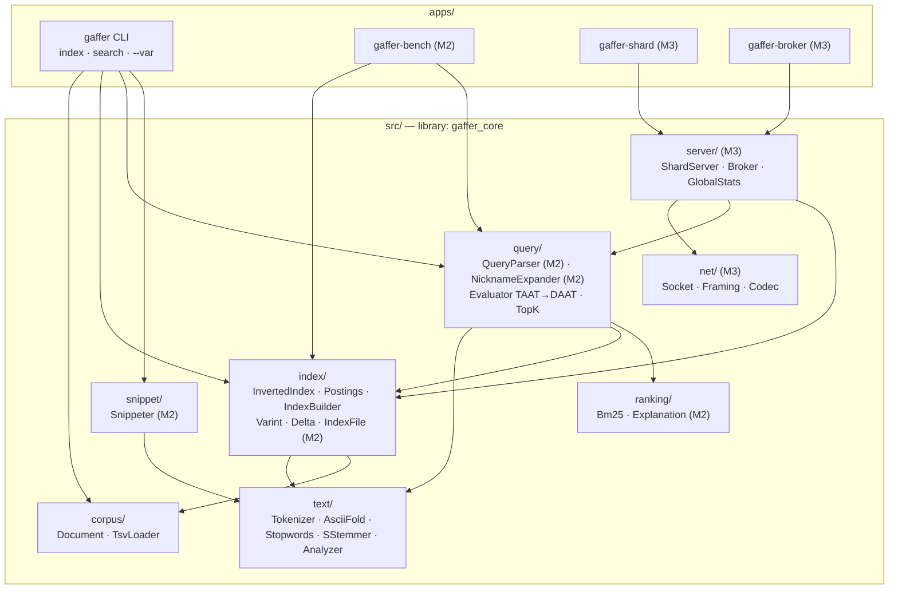
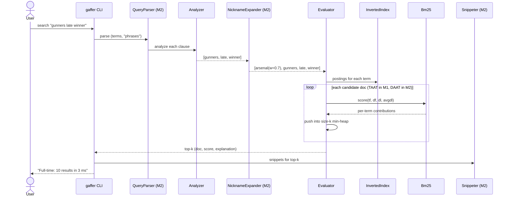
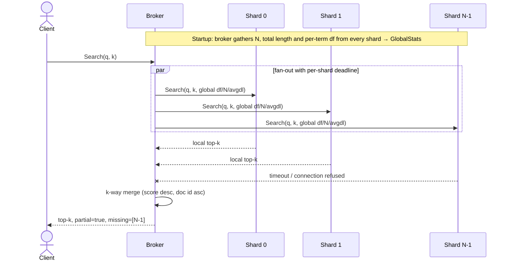

# Architecture

*Status: design draft (pre-M1). Parts marked **(M2)** or **(M3)** are planned, not built.
These diagrams are updated whenever the design changes.*

## 1. System context

## 2. Components

Dependency rule: arrows point downwards only. `text/` and `corpus/` depend on nothing else in
the project, so each module can be unit-tested in isolation.

## 3. Data flow — indexing

```mermaid
flowchart LR
    raw[1-premierleague-full.txt] --> parse[corpusgen: parse match blocks]
    parse --> derive[derive tags<br/>late winner · comeback · hat-trick ·<br/>clean sheet · derby · red card]
    derive --> write[write docs<br/>match · club · player]
    write --> tsv[(corpus.tsv)]
    tsv --> load[TsvLoader<br/>→ Document]
    load --> analyze[Analyzer<br/>tokenize → fold → stop → stem]
    analyze --> build[IndexBuilder<br/>term → postings<br/>doc lengths, N, avgdl]
    build --> mem[(In-memory index)]
    mem -- M2: delta + varint, CRC32 --> file[(index.gaffer)]
    file -- M3: partition by doc --> shards[(shard_0..N-1)]
```

## 4. Data flow — querying (single node, M1–M2)

## 5. Data flow — querying (distributed, M3)

## 6. Key design choices (details in DECISIONS.md)
- Immutable indexes: build once, query many. This makes global stats exact and cheap (D-014).
- Doc-partitioned shards (D-013).
- Raw TCP with length-prefixed frames (D-005).
- Exceptions only at load/parse boundaries (D-009).
