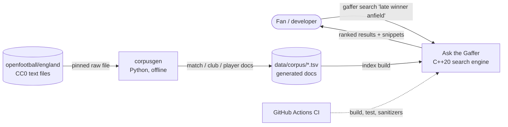
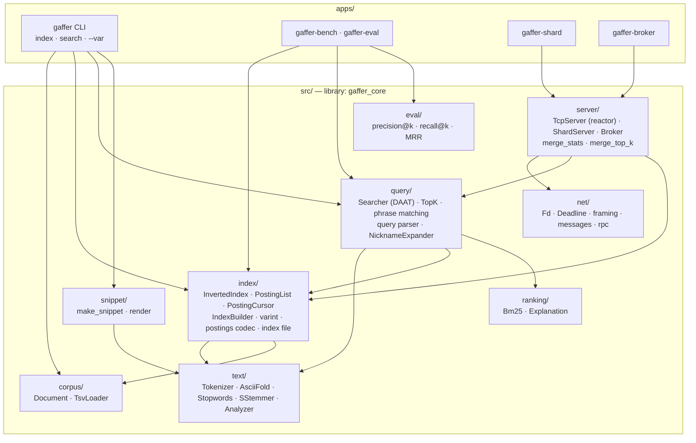
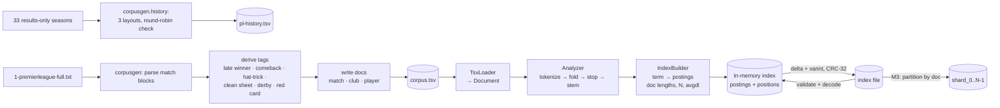
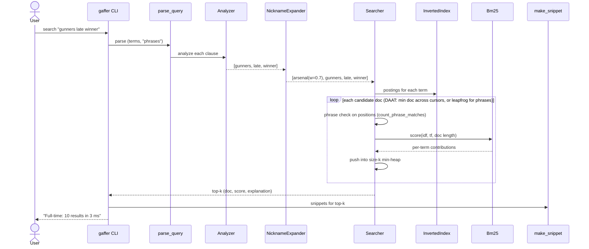
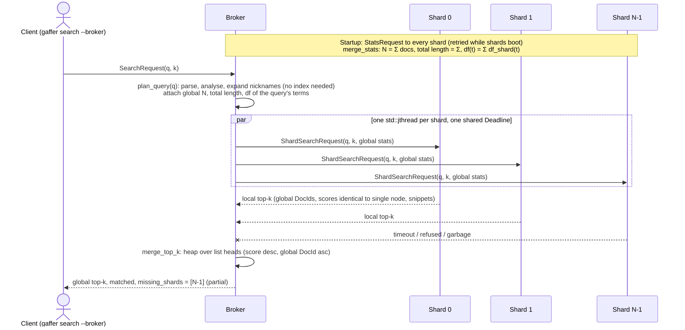
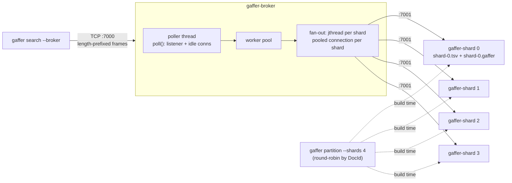

# Architecture

*Status: Milestones 1, 2 and 3 built (2026-11-04).
These diagrams are updated whenever the design changes.*

## 1. System context

## 2. Components

Dependency rule: arrows point downwards only. `text/` and `corpus/` depend on nothing else in
the project, so each module can be unit-tested in isolation.

## 3. Data flow — indexing

## 4. Data flow — querying (single node, M1–M2)

## 5. Data flow — querying (distributed, M3)

## 6. Deployment and server internals

Each server (`TcpServer`) is a reactor: one poller thread `poll()`s the listener and every idle
connection, hands ready connections to a worker pool, and gets them back through a self-pipe after
one request. Idle pooled connections cost a pollfd, not a thread (D-021).
`deploy/docker-compose.yml` runs this topology; `deploy/local-cluster.sh` runs it as local processes.

## 7. Global statistics: the trade-off

With document partitioning, each shard sees only its slice. Scoring with **local** statistics
(the shard's own N, avgdl and df) makes scores incomparable across shards. A term that's rare on
one shard but common overall gets an inflated idf there, so that shard's documents win the merge
for the wrong reason. In this corpus, one shard on its own scored Liverpool 1-2 Man Utd 10.269
for a query where the single-node score is 8.035.

| Approach | Exact? | Cost per query | Notes |
|---|---|---|---|
| Local stats per shard | no | none | Simple; skewed when term distribution differs across shards. Acceptable only with many docs per shard and random placement. |
| **Global stats gathered once, df sent per query** (ours, D-020) | **yes** | a few dozen bytes per term | Needs immutable indexes (stats never change after startup). Shards stay stateless. |
| Two-round query: ask shards for df, then search | yes | an extra round trip | Works with mutable indexes; doubles fan-out latency. |
| Push global stats to shards and cache them | yes | none | Shards become stateful: a restarted shard must be re-synced, and two brokers can disagree. |
| Approximate / sampled global df | almost | none | What large engines often accept; exactness traded for simplicity. |

Exactness is tested: sharded results equal single-node results (documents, order, and
scores compared with `==`) for N = 1–4 on every evaluation and golden query, and on the full
13,724-doc corpus with k = 50.

## 8. As built

| Module | Files | Key types / functions |
|--------|-------|-----------------------|
| common | `src/common/` | `gaffer::Error`, `IoError`, `ParseError`, `FormatError`; `DocId`; `crc32` |
| corpus | `src/corpus/` | `Document`, `Corpus`, `load_tsv(_file/_files)`, `fingerprint` |
| text | `src/text/` | `decode_utf8`, `fold_code_point`, `tokenize`, `is_stopword`, `s_stem`, `Analyzer` |
| index | `src/index/` | `partition`, `shard_of`/`global_of`, `PostingList`, `InvertedIndex`, `IndexBuilder`, `PostingCursor::advance_to`, `put_varint`/`VarintReader`, `encode/decode_posting_list`, `serialize_index`/`deserialize_index` |
| ranking | `src/ranking/` | `Bm25`, `Explanation`/`Contribution` |
| query | `src/query/` | `parse_query`, `count_phrase_matches`, `NicknameExpander`, `Searcher::search`/`explain`, `TopK`, `ranks_before` |
| snippet | `src/snippet/` | `make_snippet`, `render` |
| eval | `src/eval/` | `precision_at`, `recall_at`, `reciprocal_rank`, `load_qrels` |
| net | `src/net/` | `Fd`, `Deadline`, `IoStatus`, `read_exact`/`write_all`, `read_frame`/`write_frame`, `Message` codec, `exchange`/`call` |
| server | `src/server/` | `TcpServer` (reactor), `ShardServer`, `Broker`, `merge_stats`, `merge_top_k`, `parse_address` |
| apps | `apps/` | `gaffer` (index/search/partition/--broker), `gaffer-shard`, `gaffer-broker`, `gaffer-bench`, `gaffer-eval` |
| generators | `tools/corpusgen/`, `eval/make_qrels.py` | `parse_file`, `derive`, `render_*`, `history.parse_season`; qrels from criteria |

## 9. Key design choices (details in DECISIONS.md)
- Immutable indexes: build once, query many. This makes global stats exact and cheap (D-014).
- Doc-partitioned shards (D-013).
- Raw TCP with length-prefixed frames (D-005).
- Exceptions only at load/parse boundaries (D-009).
- Phrases required, free words optional; a phrase scores as one BM25 pseudo-term (D-015).
- Compressed on disk, decoded at load (D-017).
- Nickname expansion on raw tokens, additive, weight 0.7 (D-018).
- Round-robin partitioning by DocId (D-019); stateless shards with per-query global df (D-020);
  reactor servers and thread-per-shard fan-out (D-021).
